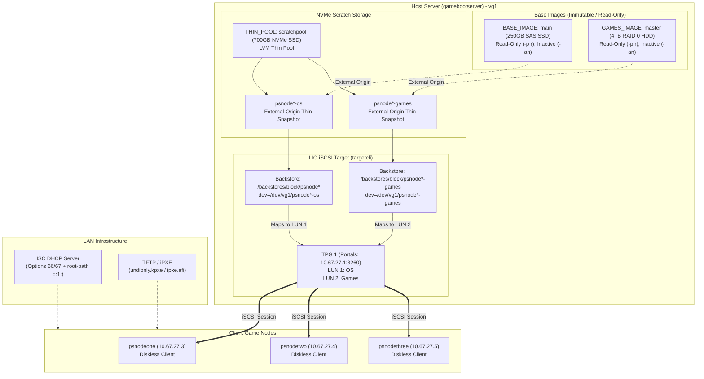
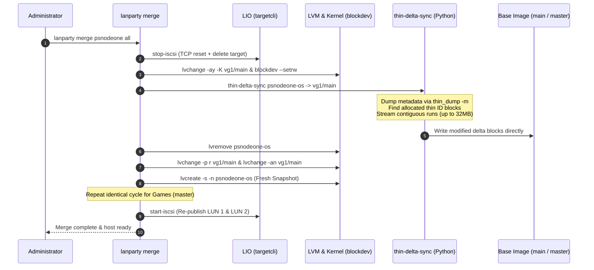

# AGENTS.md - System Architecture & Engineering Memory

This file serves as the definitive engineering manual and persistent memory for AI coding assistants and developers working on the `lanparty` repository.

---

## 1. System Overview & Architecture

The `lanparty` project provides high-performance, diskless netbooting and centralized management for fleet gaming PCs (e.g. 10–25+ identical client nodes) over iSCSI and Gigabit/10-Gigabit Ethernet. It allows a single server (`gamebootserver`) to host all operating systems and game libraries with zero local storage required on the client nodes.

### Core Architecture Diagram



---

## 2. Storage Topology & Volume Allocation

The storage layout utilizes Linux LVM2 and LVM Thin Provisioning within a single Volume Group (`VGROUP="vg1"`).

| Volume / Layer | Source Device | Mount / Visibility | Overlay Technique | iSCSI Export |
| :--- | :--- | :--- | :--- | :--- |
| **OS Base (`main`)** | 250GB SAS SSD | `vg1/main` (Deactivated, Read-Only) | **Thin Mode**: External-origin thin snapshot (`$MACHINE-os`) in `scratchpool`<br>**Legacy Fallback**: Loopback cache (`/dev/loop7`) + COW LV via `dmsetup snapshot` | **LUN 1** (matches initiator DHCP `root-path` `:::1:`) |
| **Games Base (`master`)** | 4TB RAID 0 HDD array | `vg1/master` (Deactivated, Read-Only) | **Thin Mode**: External-origin thin snapshot (`$MACHINE-games`) in `scratchpool` (`350G` virtual quota) | **LUN 2** (`GAMES_LUN=2`) |
| **Scratch Pool (`scratchpool`)** | 700GB NVMe SSD | `vg1/scratchpool` (Active LVM Thin Pool) | Hosts all transient COW writes from client sessions | Backing storage for thin snapshots |

> [!NOTE]
> **Optional Games Mode**: If `GAMES_IMAGE=""` or is omitted in `/etc/lanparty.conf`, the system transparently operates in single-drive OS-only mode, skipping all games volume creation, merging, and LUN 2 exports.

---

## 3. Command Reference & CLI Implementation

The primary entry point is the monolithic Bash script [`lanparty`](file:///home/arshad/Documents/Sync/Personal/lanparty/lanparty). It runs under strict mode (`set -euo pipefail`).

### Syntax
```bash
lanparty [-c CONFIG] [-n] COMMAND [ARGS...]
```
- `-c CONFIG`: Path to configuration file (default: `/etc/lanparty.conf`).
- `-n`: Dry-run mode. Prints all shell commands that would be executed without applying changes.

### Supported Commands

#### `init [HOSTS...]`
Initializes overlays and publishes iSCSI targets for the specified hosts (or all hosts if omitted).
1. Calls `stop-iscsi` and `delete-overlays` for existing target state.
2. Ensures base images (`BASE_IMAGE`, `GAMES_IMAGE`) are set to read-only (`-p r`) and deactivated (`-an`).
3. Creates thin snapshots for each host:
   - OS: `lvcreate -s -n "$MACHINE-os" "$VGROUP/$BASE_IMAGE" --thinpool "$VGROUP/$THIN_POOL"`
   - Games: `lvcreate -s -n "$MACHINE-games" "$VGROUP/$GAMES_IMAGE" --thinpool "$VGROUP/$THIN_POOL"`
4. Configures LIO via `targetcli`:
   - Creates block backstores for `$MACHINE` (LUN 1) and `$MACHINE-games` (LUN 2).
   - Creates target IQN `iqn.2019-12.com.example.server:$MACHINE`.
   - Binds TPG portal to `$SERVER_ADDR:3260`.
   - Maps LUN 1 and LUN 2.
   - Sets attributes: `authentication=0`, `demo_mode_write_protect=0`, `generate_node_acls=1`.

#### `destroy [HOSTS...]`
Tears down active client overlays, freeing scratch space and terminating iSCSI sessions.
1. Terminates active TCP connections on port 3260 (`ss -K dst <IP> dport 3260`).
2. Deletes LIO iSCSI targets and backstores via `targetcli`.
3. Removes client thin snapshots: `lvremove -f /dev/$VGROUP/$MACHINE-os` and `/dev/$VGROUP/$MACHINE-games`.
4. Inspects remaining thin volumes. If no external-origin snapshots depend on `BASE_IMAGE` or `GAMES_IMAGE`, it automatically restores the base volumes to active read-write (`lvchange -p rw` and `lvchange -ay`).

#### `status`
Displays current host state, ping reachability, active iSCSI sessions, and thin pool allocation percentages.
- OS status: displays thin percentage used (e.g. `0.45%`) queried via `lvs --noheadings -o data_percent`.
- Games status: displays games thin percentage used (e.g. `1.20%`).

#### `merge HOST [os|games|all]`
Merges changes made on a client node back into the base disk images, making updates persistent across all future nodes.
- Syntax: `lanparty merge psnodeone [os | games | all]` (default: `all`).
- Disconnects the merging host from iSCSI.
- Performs fast metadata-driven block streaming (see [Merge Engine Architecture](#4-merge-engine-architecture-lanparty-merge)).
- Recreates a fresh, clean snapshot for the host and restarts iSCSI.

#### `boot [HOSTS...]` / `shutdown [HOSTS...]`
- `boot`: Sends Wake-on-LAN magic packets (`wakeonlan` or `etherwake`) using MAC addresses configured in `MACHINE_TABLE`.
- `shutdown`: Connects to hosts over SSH and runs `SHUTDOWN_COMMAND` (default: `shutdown /p /f` for Windows).

#### `authorize-addr HOST ADDR`
Temporarily updates target ACLs to allow an alternative IP to connect to a host's iSCSI target (used for maintenance/troubleshooting).

#### `configure [dhcp|dns|dns-zone|dns-reverse|ipxe]`
Generates standardized configuration files for ISC DHCP, BIND 9 DNS, and iPXE boot menus based on `MACHINE_TABLE`.

---

## 4. Merge Engine Architecture (`lanparty merge`)

Merging allows updating games or the operating system from a designated node without manual disk cloning or taking the entire storage system offline.



### `thin-delta-sync` Implementation Details
Located in `lanparty` ([`thin-delta-sync()`](file:///home/arshad/Documents/Sync/Personal/lanparty/lanparty#L524-L670)):
1. **Thin ID Detection**: Extracts the snapshot's numeric thin ID using `lvs --noheadings -o thin_id "$SRC"`.
2. **Live Metadata Dump**: Executes `thin_dump -m --dev-id "$THIN_ID" "$META_DEV"` against the thin pool metadata volume (`vg1-scratchpool_tmeta`).
   - Uses `-m` (in-core metadata snapshot) to avoid requiring pool deactivation.
   - Falls back to `reserve_metadata_snap` if needed.
3. **Chunk Aggregation**: Embedded Python parses XML `<range_mapping>` and `<single_mapping>` tags, grouping adjacent thin blocks into contiguous runs of up to 32MB.
4. **Direct Streaming**: Reads modified chunks from the snapshot and writes them directly into the base logical volume, flushing with `fdatasync`/`fsync`.
5. **Efficiency**: A 250GB or 4TB drive with 2GB of game updates merges in **under 10 seconds**, bypassing gigabytes of unchanged blocks.

---

## 5. Critical Engineering Rules & Quirks

### A. LVM External Origin Lifecycle & Exit Code 5 Trap
> [!CAUTION]
> **The Exit Code 5 Trap**:
> In LVM, running `lvchange` on a volume that is *already* in the requested state (e.g. `lvchange -p r` when already read-only) prints a notice and exits with **code 5**.
> Because `lanparty` executes under `set -euo pipefail`, an unhandled exit code 5 immediately kills the entire script mid-run.

**The Golden Rules for LVM Invocations**:
1. **Inspect Before Changing**: Always check attributes via `lvs --noheadings -o lv_attr` before invoking `lvchange`:
   - Attribute index 1: `r` (read-only) vs `w` (read-write).
   - Attribute index 4: `a` (active) vs `-` (inactive).
2. **Always Guard**: Always append `|| true` to `lvchange` commands when enforcing state:
   ```bash
   doit lvchange -p r "$VGROUP/$BASE_IMAGE" || true
   doit lvchange -an "$VGROUP/$BASE_IMAGE" || true
   ```
3. **Snapshot Pre-Conditions**: In LVM, an external origin logical volume **MUST** be both read-only (`-p r`) and inactive (`-an`) before `lvcreate -s` will succeed.
4. **Teardown Recovery**: Never leave base images inactive read-only after `lanparty destroy`. Check `lvs --noheadings -o origin` to ensure no snapshots remain, then restore with `lvchange -p rw` and `lvchange -ay`.

### B. Shell Scoping (`local` Outside Functions)
> [!WARNING]
> In Bash, using `local VAR=""` outside a function body (e.g. inside top-level `case "$COMMAND" in` branches) causes a fatal syntax/runtime error: `local: can only be used in a function`.
> In top-level case statements, declare variables without the `local` keyword.

### C. Device Mapper Naming Consistency
When LVM thin snapshots are created, udev symlinks can appear under either:
- Direct dev path: `/dev/$VGROUP/$LV` (e.g. `/dev/vg1/psnodeone-os`)
- Device-mapper path: `/dev/mapper/${VGROUP}-${LV}` (with hyphen-escaping, e.g. `/dev/mapper/vg1-psnodeone--os`)

Always implement device path resolution with fallbacks:
```bash
local OSDEV="/dev/$VGROUP/$MACHINE-os"
if [ ! -e "$OSDEV" ] && [ -e "/dev/mapper/${VGROUP}-${MACHINE}--os" ]; then
  OSDEV="/dev/mapper/${VGROUP}-${MACHINE}--os"
elif [ ! -e "$OSDEV" ] && [ -e "/dev/mapper/cached-$MACHINE" ]; then
  OSDEV="/dev/mapper/cached-$MACHINE"
fi
```

### D. External Origin Write-Locking & Device-Mapper `EPERM`
> [!IMPORTANT]
> **Why `blockdev --setrw` is Not Enough**:
> When an LVM volume is configured with read-only permission (`lvchange -p r`), LVM activates it in kernel device-mapper with the `DM_READONLY_FLAG` ioctl.
> Running `blockdev --setrw` only toggles the generic block layer flag (`bdev->bd_disk->ro`), but the device-mapper driver itself continues to enforce read-only table mode. Any attempt to write blocks (`write()`) triggers `PermissionError: [Errno 1] Operation not permitted` (-EPERM).
> **The Fix (`enable-volume-writes`)**:
> During merge operations, `lanparty` queries the active device-mapper name for the volume (`dmsetup info -c --noheadings -o name "$DEV"`), extracts the table (`dmsetup table --showkeys "$DM_NAME"`), and reloads it in read-write mode via `dmsetup reload "$DM_NAME" --table "$TABLE"` followed by `dmsetup resume "$DM_NAME"`. This allows delta blocks to stream directly into the base volume without altering LVM metadata. Note: Never use manual hyphen string manipulation on device names, as device-mapper names can differ from simple VG-LV concatenation.

### E. Live `thin_dump -m` & Metadata Snapshot Reservation
> [!TIP]
> **Dumping Live Thin Pools**:
> Calling `thin_dump -m` on an active thin pool's metadata device (`_tmeta`) requires the kernel thin-pool driver to have a reserved metadata snapshot.
> 1. Reserve the snapshot: `dmsetup message <pool-tpool> 0 reserve_metadata_snap`.
> 2. Dump metadata: `thin_dump -m <_tmeta>`.
> 3. Always release the snapshot: `dmsetup message <pool-tpool> 0 release_metadata_snap`.
> 4. To support multiple versions of `thin-provisioning-tools` (some lack `--dev-id`), `lanparty` falls back to dumping the pool metadata and filters the XML on the target `dev_id` in Python.

### F. iSCSI Protocol Realities & LUN Discovery
1. **`iscsiadm -m discovery -t sendtargets`**:
   - Outputs: `10.67.27.1:3260,1 iqn...`
   - **Common Pitfall**: The `,1` is the **Target Portal Group Tag (`tpg1`)**, NOT LUN 1! `sendtargets` never reports LUN numbers.
2. **Viewing LUNs on Netboot Nodes**:
   - From the client shell: use `lsblk`, `lsscsi`, or `iscsiadm -m session -P 3`.
3. **Rescanning LUNs**:
   - If LUN 2 is added while a node is running:
     ```bash
     sudo iscsiadm -m session --rescan
     # Or via sysfs:
     for h in /sys/class/scsi_host/host*; do echo "- - -" | sudo tee "$h/scan"; done
     ```

### G. Immediate TCP Session Termination
Before tearing down LIO targets in `stop-iscsi` or `destroy`, active client connections must be forcibly killed to prevent kernel deadlocks or targetcli deletion errors:
```bash
ss -K dst "$TARGET_IP" dport 3260
```

---

## 6. Configuration Reference (`/etc/lanparty.conf`)

Example production configuration:

```bash
# Host & Network
SERVER_HOSTNAME="gamebootserver"
SERVER_ADDR="10.67.27.1"
DOMAIN="lan"
IP_PREFIX="10.67.27"
SERVER_NETWORK_INTERFACE="eth0"

# Storage Volume Group & Pool
VGROUP="vg1"
THIN_POOL="scratchpool"          # NVMe scratchpool for all thin COW overlays

# OS Configuration (LUN 1)
BASE_IMAGE="main"                # 250GB SAS SSD base boot volume
OS_COW_QUOTA="150G"              # Virtual quota for thin OS snapshots
CACHE_LOOP_DEVICE="/dev/loop7"   # Dedicated loop device for legacy caching mode

# Games Configuration (LUN 2)
GAMES_IMAGE="master"             # 4TB RAID 0 HDD array (leave empty "" to disable games)
GAMES_LUN=2                      # LUN exposed to initiator (default: 2)
GAMES_SNAPSHOT_QUOTA="350G"      # Virtual quota for thin Games snapshots

# iSCSI & Client Settings
ISCSI_TARGET_PREFIX="iqn.2019-12.com.example.server"
SHUTDOWN_COMMAND="shutdown /p /f"

# Machine Table: Name Host-Octet MAC-Address
MACHINE_TABLE="
psnodeone 3 00:11:22:33:44:01
psnodetwo 4 00:11:22:33:44:02
psnodethree 5 00:11:22:33:44:03
"
NETBOOT_MACHINES="psnodeone psnodetwo psnodethree"
```

---

## 7. Development, Verification & Deployment Workflow

### Symlink Setup on Production Server (`gamebootserver`)
Always ensure `/usr/local/bin/lanparty` points directly to the git checkout:
```bash
ln -sf ~/lanparty/lanparty /usr/local/bin/lanparty
chmod +x ~/lanparty/lanparty
```
Any `git pull` instantly updates the binary on the path.

### Pre-Commit Verification Checklist
Before committing any changes to `lanparty`:
1. **Syntax Check**:
   ```bash
   bash -n lanparty
   ```
2. **Dry-Run Full Lifecycle**:
   Use a test configuration file:
   ```bash
   ./lanparty -n -c /path/to/test.conf init
   ./lanparty -n -c /path/to/test.conf merge psnodeone os
   ./lanparty -n -c /path/to/test.conf merge psnodeone games
   ./lanparty -n -c /path/to/test.conf merge psnodeone all
   ./lanparty -n -c /path/to/test.conf destroy
   ```
3. **Verify Git Diff**: Ensure no unintended debug statements or temporary files are staged.
